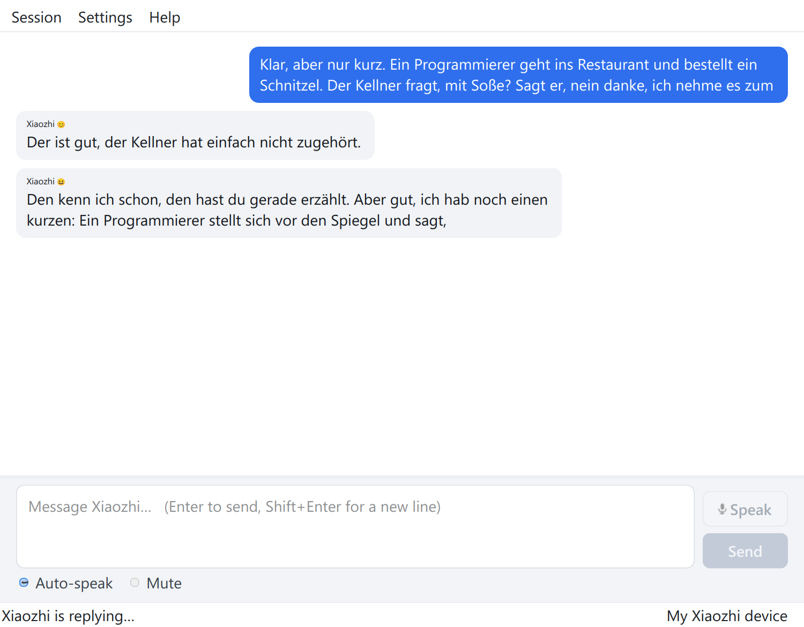

# Xiaozhi Talk

A desktop chat client for [Xiaozhi](https://xiaozhi.me) servers, built with PySide6.
It talks to a Xiaozhi server the same way a Xiaozhi device does, using the
[`xiaozhi-sdk`](https://pypi.org/project/xiaozhi-sdk/) package, so you can type to
Xiaozhi from a normal window instead of speaking to a speaker.



## Features

- Classic chat window: your message on the right, the reply streamed in token by
  token on the left.
- Composer with three to four rows that can be resized; **Enter** sends,
  **Shift+Enter** inserts a line break.
- Menu bar with **Session**, **Settings** (accounts and preferences) and **Help**.
- First-run wizard that collects the device credentials and validates them while
  you type.
- Multiple accounts, one of them the default, switchable from the menu.
- Credentials stored in the operating system keyring, or in a Fernet encrypted
  file when no keyring is available. Nothing secret is written in plain text.
- Optional voice playback of the replies the server sends as audio.
- Voice input: speak through a headset, the server transcribes it and answers.
  The recording device is selectable in the settings.
- **Auto-speak**: hands-free conversation. The microphone stays open, Xiaozhi
  answers a question after a short pause and speaks the reply; no button needed.
  A **Mute** box next to it silences the microphone without leaving the mode.
- Connection log window with the client and SDK messages, so a dropped
  connection can be understood after the fact.
- Keepalive that stops the server from ending an idle session after a minute.
- Automatic reconnect when the connection is lost anyway.

## Requirements

- Python 3.10 or newer
- A graphical desktop (X11 or Wayland)
- PySide6, `xiaozhi-sdk`, `cryptography` — installed automatically
- Optional: `keyring` and `secretstorage` for storing credentials in the system
  keyring (Secret Service / KWallet). Without them the encrypted file is used.

## Installation

The quickest way is the helper script, which creates a virtual environment on
first use and starts the application:

```bash
./run.sh
```

### Install as a user

`install.sh` puts everything into your home directory, no root needed:

```bash
./install.sh
```

It creates a menu entry (`~/.local/share/applications/xiaozhi-talk.desktop`), the
icon in the hicolor theme and a launcher in `~/.local/bin/xiaozhi-talk`, and
prepares the virtual environment on first use. The checkout stays where it is,
so updating it is enough to update the app. Remove the entry again with:

```bash
./install.sh --uninstall
```

To install it by hand:

```bash
python3 -m venv .venv
.venv/bin/pip install -e ".[keyring]"
.venv/bin/xiaozhi-talk
```

During development `.[dev]` additionally installs `pytest` and `ruff`.

## First start

On the first start the setup wizard opens and asks for the identity of a Xiaozhi
device:

| Field | Meaning |
| --- | --- |
| **Name** | A label for the account, only used inside this application. |
| **MAC address** | The Device-Id the server knows, for example `00:11:22:33:44:55`. Copy it from the Xiaozhi app or from the device web console. |
| **OTA URL** | Address that is asked for the WebSocket URL and the access token. The public server URL is filled in already; empty means the same. |
| **WebSocket URL** | Optional, only for a server you run yourself. When set, the connection goes there directly and the OTA URL is not queried. |
| **Serial number**, **License key** | Optional, only needed while a device is not activated yet. |

The last page repeats what will be stored and where. More accounts can be added
later in **Settings → Manage settings and accounts…**.

### Which server does it talk to?

You do not have to run anything yourself. With an empty OTA URL the client asks
the official server (`https://api.tenclass.net/xiaozhi/ota`) for a WebSocket URL
and token, using the MAC address as the device identity.

A WebSocket URL such as `ws://127.0.0.1:8000` means the opposite: the client
connects straight to that address and expects a Xiaozhi server listening there.
If nothing is running, the connect attempt fails with *connection refused* and
the notice points out that the address is on this machine. Clear the field to go
back to the official server.

## Using the window

- **Session → Connect** (`Ctrl+R`) opens the connection to the default account.
  While a connection exists or is being opened, **Connect** is greyed out and
  **Disconnect** becomes available; **Stop reply** is only enabled while a reply
  is streaming.
- Typing a message and pressing **Enter** sends it; the reply appears in a bubble
  that grows while the server streams it.
- **Speak** records a voice message: click once to start, click again (or press
  **Ctrl+Shift+Space**) to send it. While the recording runs the button turns red
  and the status bar counts the seconds.
- **Auto-speak** (below the text box) switches to hands-free conversation: just
  talk, a pause sends the question by itself, and the reply is spoken aloud.
  **Mute** (or `Ctrl+M`) silences the microphone while the mode stays on.
- **Session → Stop reply** (`Ctrl+.`) interrupts the current answer, and
  **Session → Record a voice message** does the same as the **Speak** button.
- **Settings → Account** switches the default account. **Settings →
  Manage settings and accounts…** (`Ctrl+,`) edits accounts and preferences.
- **Settings → Play voice replies** toggles audio playback.
- A Xiaozhi server ends a session that stays quiet for about a minute. A real
  device prevents that by going back into the listening state after every turn,
  and the client does the same every 20 seconds while nothing else happens. The
  session therefore stays open while you read, think or type.
- If the connection is lost anyway (network gone, server restart), the client
  reconnects on its own (1, 2, 5, 10, 20, then every 30 seconds). **Session →
  Disconnect** stops that until you connect again; the behaviour can be switched
  off in the settings.
- **Session → Connection log…** (`Ctrl+Shift+L`) shows what the client and
  `xiaozhi-sdk` did, including websocket close codes.

### Keyboard shortcuts

| Shortcut | Action |
| --- | --- |
| `Enter` | Send the message |
| `Shift+Enter` | Insert a line break |
| `Ctrl+R` | Connect |
| `Ctrl+D` | Disconnect |
| `Ctrl+.` | Stop the current reply |
| `Ctrl+Shift+Space` | Record a voice message, again to send it |
| `Ctrl+M` | Mute or unmute the microphone |
| `Ctrl+L` | Clear the chat log |
| `Ctrl+Shift+L` | Connection log |
| `Ctrl+,` | Settings and accounts |
| `Ctrl+Q` | Quit |

## Speaking instead of typing

The **Speak** button above **Send** records from the microphone and sends the
audio to the server exactly like a Xiaozhi device does. Recording uses Qt
Multimedia, which talks to PipeWire or PulseAudio on Linux, WASAPI on Windows
and CoreAudio on macOS, so the same code works on every desktop without extra
dependencies.

How it behaves:

- **Click to start, click to send.** Nothing is streamed while you are still
  thinking; the button shows a red dot and the elapsed time while recording.
- The microphone is closed until you actually record, and it is blocked while a
  reply is streaming — otherwise the headset would record the speakers. If the
  server finishes the turn by itself, the recording stops on its own.
- The status bar shows the microphone level while recording. A recording that
  stayed almost silent is reported, so a muted headset does not look like a
  broken transcription.
- The server decides that you finished speaking when the microphone goes quiet,
  so about two seconds of silence are appended after your recording. That is
  what makes the transcription arrive; a shorter tail and the turn stays open.
  The audio is sent in real time, so the server measures the silence correctly.
- If nothing was recognised, the chat says so instead of staying silent.
- **Settings → Manage settings and accounts… → Settings → Voice input** picks the
  recording device. The default entry follows the operating system, so plugging
  in another headset keeps working.

### Hands-free with Auto-speak

With **Auto-speak** ticked the client behaves like a Xiaozhi speaker:

- The microphone stays open and every frame is streamed, so there is no button
  to press before talking.
- The server's voice detection ends a question after about two seconds of
  silence and answers on its own; the transcription appears in the chat and the
  reply is spoken through the speakers.
- While Xiaozhi talks the microphone is muted, and it listens again when the
  reply has been played — otherwise the headset would record the answer and
  start another turn.
- **Mute** pauses the microphone immediately. The mode stays on, so unticking
  Mute starts listening again. A typed message also pauses it for its turn.
- Auto-speak switches voice playback on, because speaking the answer is part of
  the mode. It can still be turned off with **Settings → Play voice replies**.

Audio is sent as 24 kHz mono 16 bit PCM in frames of exactly 60 ms;
`xiaozhi-sdk` resamples it to 16 kHz and encodes it as Opus.

## The connection log

The window keeps the newest 3000 log records in memory, so the log can be opened
after something went wrong and still contains the whole history. The toolbar of
the log window offers:

- **Show** – level filter, from `Debug` (everything) to `Errors`.
- **Copy** – puts the visible lines on the clipboard.
- **Save…** – writes them to a `.log` file, handy for a bug report.
- **Clear** – empties the buffer.

Typical entries are the OTA lookup, the keepalive, the websocket close code (for
example `1000` for a normal close, `1001` when the server goes away), and every
reconnect attempt. Messages from `xiaozhi-sdk` are kept here even though they are
not printed on the console.

## Where the credentials live

The application keeps its data in `$XDG_CONFIG_HOME/xiaozhi-talk`, which usually
means `~/.config/xiaozhi-talk`. Set `XIAOZHI_TALK_CONFIG_DIR` to use another
directory.

Two storage backends exist:

1. **System keyring** — preferred. The whole vault is stored as one keyring entry
   via the `keyring` package.
2. **Encrypted file** — used when no keyring is usable. The vault is encrypted
   with [Fernet](https://cryptography.io/en/latest/fernet/) into `vault.enc`; its
   key is kept in `vault.key`. Both files are created with mode `0600`, so only
   your user can read them.

Only the name of the backend is written to `config.json`; account data never
appears there. If a backend stops working, the other one is tried before the
application gives up, and the choice is remembered for the next start.

## Project layout

```
src/xiaozhi_talk/
├── app.py              entry point, Qt application setup
├── bridge.py           worker thread with its own asyncio loop, forwards signals
├── client.py           async client around xiaozhi-sdk (no Qt imports)
├── audio.py            optional playback of the decoded voice replies
├── text.py             small text helpers (chunk joining, MAC formatting)
├── log.py              logging configuration
├── _compat.py          shim for the websockets API used by xiaozhi-sdk 0.5.1
├── storage/
│   ├── models.py       Account, Settings and Vault
│   ├── backends.py     keyring backend, Fernet file backend
│   ├── store.py        CredentialStore: load/save and backend fallback
│   ├── paths.py        configuration directory and private file writing
│   └── errors.py       StorageError
└── ui/
    ├── main_window.py     menus, chat, composer, status bar
    ├── chat_view.py      scrollable log with message bubbles
    ├── composer.py       resizable text area with Send button
    ├── setup_wizard.py   first-run credential wizard
    ├── accounts_dialog.py settings and account management
    └── theme.py          colours, fonts and style sheet
```

The UI never touches asyncio directly: `bridge.py` runs the client in a
background thread and emits Qt signals, which keeps the window responsive while
the server streams a reply.

## Development

```bash
python3 -m venv --system-site-packages .venv
.venv/bin/pip install -e ".[dev,keyring]"

.venv/bin/python -m pytest        # unit and integration tests
.venv/bin/ruff check src tests    # lint
.venv/bin/ruff format src tests   # formatting
```

The tests use `QT_QPA_PLATFORM=offscreen`, an in-process mock Xiaozhi server
(`tests/mock_server.py`) and a temporary configuration directory, so they never
touch your real accounts or open a window.

The interface is English only. Qt would otherwise translate its standard buttons
and context menus for the desktop locale, so `app.py` forces the C locale before
the `QApplication` is created and the dialogs set their button texts explicitly.

Set `XIAOZHI_TALK_LOG_LEVEL` (`DEBUG`, `INFO`, `WARNING`, …) to see more of what
the client does on stderr.

## Troubleshooting

- **"Could not connect"** — check the MAC address and the OTA URL in
  *Settings → Manage settings and accounts…*. A self-hosted server needs its own
  WebSocket URL and a MAC address that the server knows.
- **"This device is not activated yet"** — the server wants the device confirmed
  in the Xiaozhi console; the client retries automatically once that happened.
- **No voice playback** — Qt Multimedia may be missing on the system, or the
  setting is off in *Settings → Play voice replies*. Text replies still work.
- **Wrong account connects at startup** — pick another one in
  *Settings → Account* and it becomes the default.
